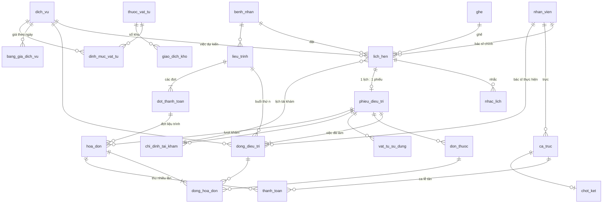
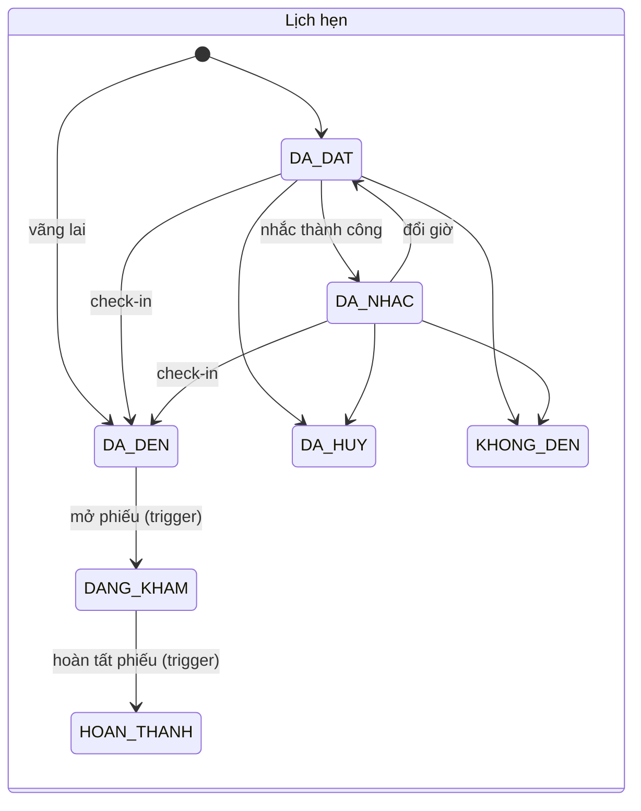

# Kiến trúc dữ liệu — ClinicCyberDB

> Liên quan: [overview.md](overview.md) · [use-case.md](../requirements/use-case.md) · [quyet-dinh.md](../../../database/quyet-dinh.md) · mã nguồn SQL: [database/ClinicCyberDB/](../../../database/ClinicCyberDB/)

---

## 1. Thông tin chung

| Mục | Giá trị |
|---|---|
| Hệ quản trị | PostgreSQL 18, chạy trong Docker (container `phong_kham_db`) |
| Database | `ClinicCyberDB`, mã hóa UTF8, múi giờ phiên `Asia/Ho_Chi_Minh` |
| Chủ sở hữu | `LienAdmin`: sở hữu database, schema `public` và mọi bảng; **không** phải superuser của server |
| Extension | `btree_gist` (chống chồng ca), `pg_trgm` + `unaccent` (tìm tên không dấu), `pgcrypto` (băm mật khẩu) |
| Quy mô | 32 bảng · 18 view · khoảng 40 hàm / trigger |

**File cài đặt** (chạy theo thứ tự bằng `cai_dat.sh`):

| File | Nội dung |
|---|---|
| `00_tao_database.sql` | Tạo role `LienAdmin` (mật khẩu truyền vào từ `.env`) và database |
| `01_schema.sql` | Bảng, khóa, ràng buộc `CHECK` / `UNIQUE` / `EXCLUDE`, chỉ mục |
| `02_trigger_ham.sql` | Trigger giữ luật nghiệp vụ, hàm nghiệp vụ |
| `03_view_bao_cao.sql` | View màn hình hằng ngày và báo cáo 8 câu hỏi |
| `04_du_lieu_mau.sql` | Danh mục, 7 nhân viên, ca trực 14 ngày tới, bệnh nhân / lịch hẹn / liệu trình mẫu |

---

## 2. Quy ước thiết kế

- **Tên** bảng / cột: tiếng Việt không dấu, `snake_case` (vd. `lich_hen.gio_bat_dau`).
- **Khóa chính:** `id` kiểu `GENERATED ALWAYS AS IDENTITY`. Mã hiển thị cho người dùng sinh từ sequence: `BN000123`, `PDT0000001`, `HD0000001`, `PT0000001`, `LT000001`.
- **Trạng thái / loại:** `text` IN HOA + `CHECK` (vd. `'DA_DAT'`, `'TIEN_MAT'`). Cách này dễ thêm giá trị hơn `ENUM`.
- **Tiền:** domain `so_tien = numeric(14,0)`, VND, không âm, không có phần lẻ.
- **Không xóa cứng** bệnh nhân, nhân viên, lịch hẹn, phiếu, hóa đơn, liệu trình (A26). Thay vào đó dùng `dang_hoat_dong` hoặc trạng thái `DA_HUY`. Trigger chặn `DELETE`.
- **Bảng sổ cái chỉ được thêm:** `giao_dich_kho`, `thanh_toan`, `chot_ket`, `lich_su_lich_hen`, `lich_su_sua_phieu`.
- **Người thao tác:** ứng dụng chạy `SET LOCAL app.nhan_vien_id = '<id>'` trong mỗi transaction. Hàm `nguoi_dung_hien_tai()` đọc giá trị này và được dùng làm `DEFAULT` cho các cột `tao_boi`, `nhan_vien_id`…

---

## 3. Các nhóm bảng

| Nhóm | Bảng | Use case |
|---|---|---|
| Tài khoản | `vai_tro`, `nhan_vien`, `nhan_vien_vai_tro`, `ty_le_an_chia` | UC01–03, UC44 |
| Danh mục chung | `ghe`, `gio_mo_cua`, `ngay_nghi`, `ly_do_huy` | UC43 |
| Ca trực | `ca_truc` | UC09–10 |
| Bệnh nhân | `benh_nhan`, `tai_lieu_ho_so` | UC04–08 |
| Lịch hẹn | `lich_hen`, `lich_su_lich_hen`, `nhac_lich` | UC11–19 |
| Khám & điều trị | `phieu_dieu_tri`, `dong_dieu_tri`, `don_thuoc`, `vat_tu_su_dung`, `chi_dinh_tai_kham`, `lieu_trinh`, `dot_thanh_toan`, `lich_su_sua_phieu` | UC20–29 |
| Giá & kho | `dich_vu`, `bang_gia_dich_vu`, `thuoc_vat_tu`, `bang_gia_thuoc`, `dinh_muc_vat_tu`, `giao_dich_kho` | UC30, UC38–42 |
| Thanh toán | `hoa_don`, `dong_hoa_don`, `thanh_toan`, `chot_ket` | UC31–37 |

---

## 4. Sơ đồ quan hệ (các bảng cốt lõi)

---

## 5. Ba quyết định thiết kế (chi tiết: [quyet-dinh.md](../../../database/quyet-dinh.md))

| QĐ | Vấn đề | Lời giải trong DB |
|---|---|---|
| **QĐ1** Hai bác sĩ cùng làm | Luật "một lịch một bác sĩ" nhưng cần tính doanh thu đúng người | `lich_hen.bac_si_id` và `phieu_dieu_tri.bac_si_chinh_id` chỉ có một bác sĩ; **mỗi `dong_dieu_tri` có `bac_si_thuc_hien_id`** (mặc định là bác sĩ chính). Bác sĩ phụ đang có lịch riêng → chỉ `RAISE WARNING` |
| **QĐ2** Trẻ em dùng chung SĐT của mẹ | SĐT không còn là định danh | `ma_benh_nhan` **UNIQUE** là định danh; `so_dien_thoai` có chỉ mục nhưng **không unique**; `ngay_sinh` bắt buộc; thêm `nguoi_giam_ho`, `quan_he_giam_ho` |
| **QĐ3** Giảm giá ở dòng hay ở tổng | Báo cáo theo bác sĩ cần biết dòng nào bị giảm | Lưu cả `dong_hoa_don.giam_gia_dong` và `hoa_don.giam_gia_tong`; hàm `chot_hoa_don()` **phân bổ giảm tổng xuống dòng** (`giam_gia_phan_bo`, phần lẻ dồn vào dòng lớn nhất); bất biến `tong_tien = Σ thanh_tien` |

---

## 6. Luật nghiệp vụ được database giữ

### 6.1 Ràng buộc trên bảng

| Luật | Cách giữ |
|---|---|
| Không trùng ghế / bác sĩ trong cùng khung | 2 chỉ mục `UNIQUE (ghe_id \| bac_si_id, ngay, gio_bat_dau) WHERE trang_thai NOT IN ('DA_HUY','KHONG_DEN')` |
| Một lịch = đúng một khung 30 phút (A06) | `CHECK` phút ∈ {0, 30}; `gio_ket_thuc` là cột sinh = bắt đầu + 30′ |
| Một nhân viên không có hai ca chồng giờ | `EXCLUDE USING gist (nhan_vien_id WITH =, tsrange(...) WITH &&)` |
| Răng ghi theo FDI hoặc vùng (A15) | `CHECK rang ~ '^([1-4][1-8]\|[5-8][1-5])$' OR rang IN ('HAM_TREN','HAM_DUOI','TOAN_HAM')` |
| Hủy lịch phải đủ lý do, bên hủy, người hủy, thời điểm (A12) | `CHECK` đủ cả 4 cột khi `trang_thai = 'DA_HUY'` |
| Không thu vượt nợ (A22) | `CHECK da_thu <= tong_tien`; `con_no` là cột sinh |
| Hủy hóa đơn chỉ khi chưa thu (A23) | `CHECK trang_thai <> 'DA_HUY' OR da_thu = 0` |
| Mỗi phiếu / đợt chỉ một hóa đơn còn hiệu lực | `UNIQUE ... WHERE trang_thai <> 'DA_HUY'` |
| Chốt két lệch phải giải trình (A25) | `CHECK tien_mat_dem_duoc = tien_dau_ca + tien_mat_thu_trong_ca OR giai_trinh IS NOT NULL` |

### 6.2 Trigger

| Trigger (bảng) | Việc làm | Luật |
|---|---|---|
| `trg_lich_hen_truoc` | Kiểm tra bác sĩ, ghế, giờ mở cửa, ngày nghỉ, **ca trực**; chỉ cho chuyển trạng thái đúng thứ tự; đổi giờ thì quay về `DA_DAT` để nhắc lại | UC12–15, A09, A11 |
| `trg_lich_hen_nhat_ky` | Ghi `lich_su_lich_hen` khi tạo / đổi lịch / đổi trạng thái | UC14 |
| `trg_nhac_lich_cap_nhat` | Gọi được hoặc gửi SMS → lịch chuyển `DA_NHAC` | UC16–17 |
| `trg_ca_truc_kiem_tra` (deferred) | Đúng vai trò; sửa / xóa ca không được để lịch hẹn nằm ngoài ca; ca lễ tân đã có phiếu thu thì không xóa | UC09 |
| `trg_phieu_truoc` / `trg_phieu_sau` | Chỉ lập phiếu cho lịch `DA_DEN`; **chép bệnh nhân, bác sĩ, ngày từ lịch** (A16); hoàn tất cần ≥ 1 dòng → lịch `HOAN_THANH`, **trừ kho** vật tư + thuốc, `RAISE WARNING` nếu dưới ngưỡng | UC21, UC26, UC42 |
| `trg_dong_dieu_tri_truoc` | Mặc định bác sĩ thực hiện = bác sĩ chính; liệu trình phải cùng bệnh nhân và đang thực hiện; **khóa dòng khi phiếu đã có hóa đơn** | QĐ1, A24 |
| `trg_*_lich_su` (5 bảng của phiếu) | Ghi `lich_su_sua_phieu`: bảng, thao tác, **chỉ các trường thay đổi** (cũ → mới), người, thời điểm | UC28–29 |
| `trg_bang_gia_*_bao_ve` | Không sửa giá đã có; không xóa giá đã hiệu lực | A21 |
| `trg_lieu_trinh_tong_dot` (deferred) | Tổng các đợt = giá trọn gói, kiểm tra lúc `COMMIT` | A20 |
| `trg_hoa_don_truoc` | Nháp: tự tính tổng; chốt: kiểm tra bất biến QĐ3; đã chốt: khóa giá và tiền; `da_thu` chỉ đổi qua `thanh_toan` | A21, A23, QĐ3 |
| `trg_dong_hoa_don_truoc` | Chỉ sửa dòng khi hóa đơn còn nháp; dòng thuộc liệu trình không được tính tiền | A20 |
| `trg_thanh_toan_truoc` / `_sau` | Hóa đơn đã chốt; không vượt nợ; ca lễ tân chưa chốt két → cộng `da_thu` | UC34, A22 |
| `trg_chot_ket_truoc` | Tự tính tiền mặt và chuyển khoản trong ca | UC37 |
| `trg_giao_dich_kho_ton` / `trg_thuoc_vat_tu_khoa_ton` | Tồn kho chỉ đổi qua sổ kho; ghi `ton_sau` | UC40–41 |
| `tg_khong_xoa_cung`, `tg_chi_duoc_them` | Chặn xóa cứng; khóa bảng nhật ký / sổ cái | A26 |

### 6.3 Hàm nghiệp vụ

| Hàm | Dùng cho |
|---|---|
| `tim_khung_trong(ngay, bac_si_id)` | UC12: khung trống ∩ ca trực, kèm danh sách ghế còn trống; `NULL` = bác sĩ nào cũng được (A08) |
| `gia_dich_vu(id, ngay)`, `gia_thuoc(id, ngay)` | Giá có hiệu lực vào một ngày (A21) |
| `goi_y_vat_tu(phieu)`, `ap_dung_goi_y_vat_tu(phieu)` | UC26: Σ định mức × số lượng dòng (A19) |
| `lap_hoa_don_luot_kham(phieu)` | UC31: dòng dịch vụ ngoài liệu trình + thuốc, giá theo ngày khám |
| `lap_hoa_don_dot_lieu_trinh(dot)` | UC33 |
| `chot_hoa_don(hd)` | QĐ3: phân bổ giảm tổng, khóa hóa đơn |
| `huy_hoa_don(hd, ly_do)` | A23 |
| `goi_y_phan_bo_thanh_toan(bn, so_tien)` | A22: khách trả gộp, chia vào hóa đơn cũ trước |
| `kiem_ke(mat_hang, ton_thuc_te, ly_do)` | UC41: ghi giao dịch điều chỉnh phần chênh |
| `cong_suat_ghe(tu, den)` | UC45.2 |
| `chia_tien_bac_si(thang)`, `so_sanh_doanh_thu_bac_si(thang)` | UC44, UC45.8 |

---

## 7. Vòng đời trạng thái

| Đối tượng | Trạng thái |
|---|---|
| Phiếu điều trị | `DANG_LAP` → `HOAN_TAT` (không mở lại) |
| Hóa đơn | `NHAP` → `DA_CHOT` → (thu tiền nhiều lần); `NHAP` / `DA_CHOT` chưa thu → `DA_HUY` |
| Liệu trình | `DANG_THUC_HIEN` → `HOAN_THANH` hoặc `DA_HUY` |

---

## 8. View báo cáo — tám câu hỏi của quản lý

Định nghĩa **doanh thu** (A28) = Σ `thanh_tien` các dòng của hóa đơn **đã chốt**, tính theo **ngày làm dịch vụ**. **Thực thu** = tiền đã nhận (`thanh_toan`).

| # | Câu hỏi | View / hàm |
|---|---|---|
| 1 | Mỗi bác sĩ làm ra bao nhiêu tiền | `v_doanh_thu_bac_si_thang` (tách dịch vụ / liệu trình / thuốc) |
| 2 | Ghế nào trống nhiều nhất, khung giờ nào | `cong_suat_ghe(tu, den)`; lịch hủy / không đến vẫn tính là trống (A30) |
| 3 | Bệnh nhân quá 6 tháng chưa quay lại | `v_benh_nhan_qua_6_thang`; gồm cả ngày khám trên hồ sơ giấy, loại người đã có lịch sắp tới (A31) |
| 4 | Việc gì hay bị hủy, vì lý do gì | `v_thong_ke_huy_lich` |
| 5 | Tổng nợ, chia theo từng người | `v_cong_no_benh_nhan` |
| 6 | Liệu trình đang dở, còn mấy buổi | `v_lieu_trinh_dang_do` |
| 7 | Thuốc / vật tư sắp hết | `v_canh_bao_ton_kho` (kèm mức dùng TB/ngày, ước còn bao nhiêu ngày) |
| 8 | Doanh thu tăng / giảm bao nhiêu % so với tháng trước | `v_so_sanh_doanh_thu_thang`, `so_sanh_doanh_thu_bac_si(thang)` |
| — | Chia tiền theo bác sĩ (UC44) | `chia_tien_bac_si(thang)`: tỷ lệ có hiệu lực vào ngày làm từng dòng |
| — | Lịch sử chốt két (UC46) | `v_lich_su_chot_ket` |

**View cho màn hình hằng ngày:** `v_lich_hen`, `v_danh_sach_nhac_lich`, `v_danh_sach_cho_kham`, `v_phieu_dieu_tri` (liệt kê mọi bác sĩ tham gia, QĐ1), `v_phieu_cho_lap_hoa_don`, `v_tai_kham_chua_dat`, `v_bang_gia_hien_hanh`, `v_benh_nhan_tong_quan`, `v_doanh_thu_dong`, `v_thuc_thu_thang`.

---

## 9. Chỉ mục chính

| Chỉ mục | Phục vụ |
|---|---|
| `ix_benh_nhan_sdt` | Tra cứu theo SĐT ở quầy (UC04) |
| `ix_benh_nhan_ten_trgm` (GIN trigram trên `khong_dau(ho_ten)`) | Tìm tên gõ không dấu, gần đúng |
| `ux_lich_hen_ghe_khung`, `ux_lich_hen_bac_si_khung` | Chống trùng lịch, đồng thời tăng tốc tìm khung trống |
| `ix_lich_hen_ngay_trang_thai` | Lưới lịch theo ngày, nhắc lịch |
| `ix_hoa_don_con_no` (partial) | Công nợ |
| `ix_dong_hoa_don_bac_si` | Doanh thu theo bác sĩ |
| `ix_thanh_toan_ca` | Chốt két theo ca |

---

## 10. Vận hành

| Việc | Cách làm |
|---|---|
| Cài mới | `bash database/ClinicCyberDB/cai_dat.sh` |
| Cài lại từ đầu (**xóa hết dữ liệu**) | `bash database/ClinicCyberDB/cai_dat.sh --lam-lai` |
| Kết nối bằng pgAdmin | http://localhost:5050 → server "Local Postgres (Docker)" → database `ClinicCyberDB`, user `LienAdmin` |
| Mật khẩu | Chỉ nằm trong `.env` (đã `.gitignore`); không ghi vào file SQL |
| Lưu trữ | Giữ tối thiểu 5 năm kể từ lần khám cuối (A26); hệ thống không tự xóa hồ sơ hết hạn |
| Sao lưu (đề xuất) | `docker exec phong_kham_db pg_dump -U LienAdmin -d ClinicCyberDB -Fc > backup.dump` theo lịch hằng ngày |
