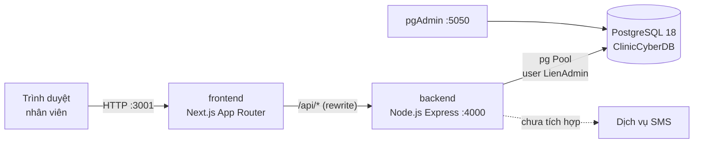
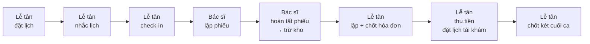

# Kiến trúc tổng thể — Hệ thống quản lý Nha khoa Nụ Cười Việt

> Liên quan: [use-case.md](../requirements/use-case.md) · [database.md](database.md) · [quyet-dinh.md](../../../database/quyet-dinh.md) · [Sơ đồ màn hình (draw.io)](../ui-ux/man-hinh-tong-quan.drawio)

---

## 1. Bức tranh chung

Hệ thống web **nội bộ** cho nhân viên phòng khám (lễ tân, bác sĩ, quản lý). Bệnh nhân không đăng nhập (A01).



| Tầng | Công nghệ | Thư mục | Trách nhiệm |
|---|---|---|---|
| Giao diện | Next.js 16 (App Router), React 19, CSS thuần | `frontend` | 25 màn hình, điều hướng theo vai trò, gọi API |
| API | Node.js 26, Express 5, `pg`, `jsonwebtoken` | `backend` | Xác thực, phân quyền, chuyển yêu cầu thành SQL, trả lỗi tiếng Việt |
| Dữ liệu | PostgreSQL 18 (Docker) | `database/ClinicCyberDB` | Lưu trữ **và giữ luật nghiệp vụ** bằng ràng buộc, trigger, hàm, view |

**Nguyên tắc chính:** luật nghiệp vụ nằm ở database. API mỏng và giao diện chỉ hiển thị. Như vậy dù dữ liệu đi vào từ web, pgAdmin hay script, luật vẫn được giữ: không trùng ghế, không thu vượt nợ, không sửa giá đã chốt…

---

## 2. Cấu trúc thư mục

```
buoi_3_4/
├── backend/                # Node.js Express — API :4000
│   └── src/
│       ├── index.js        # khởi tạo Express, gắn route, middleware cảnh báo
│       ├── db.js           # Pool, q/q1, tx() đặt app.nhan_vien_id, cauUpdate()
│       ├── auth.js         # JWT cookie, requireAuth, can(...vai trò)
│       ├── loi.js          # đổi lỗi PostgreSQL → thông báo tiếng Việt
│       └── routes/         # mỗi file một nhóm use case
│           ├── auth.js         UC01–02
│           ├── chung.js        danh mục dropdown, số liệu trang chủ
│           ├── benhNhan.js     UC04–08
│           ├── caTruc.js       UC09–10
│           ├── lichHen.js      UC11–19
│           ├── kham.js         UC20–29
│           ├── thanhToan.js    UC31–37
│           ├── kho.js          UC30, UC38–42
│           ├── quanTri.js      UC03, UC43
│           └── baoCao.js       UC44–46
├── frontend/               # Next.js App Router — giao diện :3001
│   ├── app/
│   │   ├── dang-nhap/          # trang đăng nhập (không có menu)
│   │   ├── in/hoa-don/[id]/    # trang in biên lai (không có menu)
│   │   └── (app)/              # mọi trang nghiệp vụ, bọc bởi Shell (menu + kiểm tra đăng nhập)
│   │       ├── lich-hen/  benh-nhan/  kham/  thanh-toan/
│   │       ├── ca-truc/  bang-gia/  kho/  bao-cao/  quan-tri/
│   │       └── page.js         # trang chủ
│   ├── components/             # Shell, ui (Card, Modal, toast…), RangPicker, LichHenModal…
│   └── lib/                    # api.js (fetch + useData), format.js (tiền, ngày), nhan.js (nhãn trạng thái)
├── database/               # quyet-dinh.md + ClinicCyberDB/ (00 → 04 *.sql, cai_dat.sh)
├── pgadmin/servers.json    # server khai báo sẵn cho pgAdmin
├── docker-compose.yml      # PostgreSQL 18 + pgAdmin
├── package.json            # lệnh chung: db:up, db:setup, install:all, dev, build, start
└── .env                    # cấu hình + mật khẩu (gitignore)
```

---

## 3. Luồng một yêu cầu

```mermaid
sequenceDiagram
    participant B as Trình duyệt
    participant N as Next.js (:3001)
    participant E as Express (:4000)
    participant P as PostgreSQL

    B->>N: POST /api/thanh-toan/hoa-don/7/thu-tien (cookie phien)
    N->>E: chuyển tiếp nguyên vẹn (rewrite)
    E->>E: requireAuth: xác minh JWT, nạp nhân viên + vai trò
    E->>E: can('LE_TAN','QUAN_LY')
    E->>P: BEGIN; set_config('app.nhan_vien_id', 6)
    E->>P: INSERT INTO thanh_toan ...
    P->>P: trigger: hóa đơn đã chốt? không vượt nợ? ca chưa chốt két?
    P-->>E: OK (hoặc RAISE EXCEPTION 'Số tiền thu vượt số còn nợ…')
    E->>P: COMMIT / ROLLBACK
    E-->>B: 201 {id, ma_phieu_thu} hoặc 400 {loi: "…"}
```

- **Rewrite trong Next.js** (`next.config.mjs`): trình duyệt chỉ làm việc với một địa chỉ (cổng 3001), nên cookie đăng nhập dùng được mà không cần cấu hình CORS.
- **`tx(req, fn)`** (`db.js`): mọi thao tác ghi chạy trong một transaction và gọi `SET LOCAL app.nhan_vien_id`. Nhờ đó các cột `tao_boi`, `huy_boi`, `nhan_vien_id` và bảng nhật ký tự ghi đúng người thao tác.
- **Cảnh báo:** khi trigger `RAISE WARNING` (vd. tồn kho dưới ngưỡng lúc hoàn tất phiếu), API gom lại vào trường `canh_bao`, giao diện hiện thành toast màu cam.
- **Lỗi:** `loi.js` đổi mã lỗi PostgreSQL (`P0001`, `23505`, `23514`, `23P01`…) và tên ràng buộc thành câu tiếng Việt.

---

## 4. Xác thực và phân quyền

| Nội dung | Cách làm |
|---|---|
| Đăng nhập (UC01) | So mật khẩu ngay trong DB: `mat_khau_hash = crypt($mat_khau, mat_khau_hash)` (bcrypt, `pgcrypto`) |
| Phiên | JWT `{id}` trong cookie `phien` (httpOnly, SameSite=Lax, 12 giờ). Khóa ký: `CLINIC_JWT_SECRET` |
| Mỗi yêu cầu | Nạp lại nhân viên từ DB → tài khoản bị khóa thì mất quyền ngay |
| Vai trò | `LE_TAN`, `BAC_SI`, `QUAN_LY`; một người có thể giữ nhiều vai (A03) |
| Phân quyền API | Middleware `can(...)` theo nhóm route |
| Phân quyền giao diện | Menu và nút ẩn / hiện theo vai trò (`coVaiTro`). Đây chỉ là tiện lợi; API mới là nơi chặn thật |

| Nhóm chức năng | Lễ tân | Bác sĩ | Quản lý |
|---|:-:|:-:|:-:|
| Xem lịch hẹn, bệnh nhân, ca trực, bảng giá | ● | ● | ● |
| Đặt / đổi / hủy lịch, nhắc lịch, check-in, đăng ký bệnh nhân | ● | | ● |
| Xem bệnh án (chẩn đoán, việc đã làm, thuốc) | | ● | ● |
| Phiếu điều trị, kê đơn, vật tư, liệu trình | | ● | ● |
| Hóa đơn, thu tiền, công nợ, chốt két | ● | | ● |
| Xếp ca, sửa bảng giá, kho, định mức | | | ● |
| Báo cáo, nhân viên, danh mục chung | | | ● |

---

## 5. Màn hình ↔ use case

| Nhóm | Màn hình | UC |
|---|---|---|
| Tài khoản | Đăng nhập, Đổi mật khẩu, Nhân viên & phân quyền | UC01–03 |
| Bệnh nhân | Tra cứu (SĐT / tên không dấu / mã), Đăng ký mới (cảnh báo SĐT dùng chung, chuyển hồ sơ giấy), Hồ sơ | UC04–08 |
| Ca trực | Lịch trực theo tuần, xếp ca nhiều ngày một lần | UC09–10 |
| Lịch hẹn | Lưới ghế × khung 30′, Đặt / đổi lịch (tìm khung trống), Nhắc lịch + SMS, hộp thoại check-in / hủy / không đến | UC11–19 |
| Khám | Chờ khám, Phiếu điều trị (sơ đồ răng FDI, bác sĩ cùng làm, liệu trình, thuốc, vật tư, tái khám), Lịch sử sửa phiếu | UC20–29 |
| Thanh toán | Quầy thanh toán, Hóa đơn (giảm dòng / tổng, chốt, thu, hủy), In biên lai, Công nợ (thu gộp), Chốt két | UC31–37 |
| Danh mục & kho | Bảng giá, Kho (tồn, nhập, kiểm kê, cảnh báo), Định mức vật tư, Danh mục chung | UC30, UC38–43 |
| Báo cáo | 8 câu hỏi quản lý + chia tiền bác sĩ + lịch sử chốt két | UC44–46 |

Sơ đồ điều hướng và wireframe: [man-hinh-tong-quan.drawio](../ui-ux/man-hinh-tong-quan.drawio).

---

## 6. Ba luồng nghiệp vụ chính

**Một lượt khám** (đi qua cả ba vai trò):



| Bước | Trạng thái lịch hẹn | Dữ liệu sinh ra |
|---|---|---|
| Đặt lịch | `DA_DAT` | `lich_hen`, `lich_su_lich_hen` |
| Nhắc lịch | `DA_NHAC` | `nhac_lich` |
| Check-in | `DA_DEN` | `den_luc`, `tiep_don_boi` |
| Lập phiếu | `DANG_KHAM` | `phieu_dieu_tri`, `dong_dieu_tri`, `don_thuoc`, `vat_tu_su_dung`, `chi_dinh_tai_kham` |
| Hoàn tất phiếu | `HOAN_THANH` | `giao_dich_kho` (xuất) |
| Hóa đơn → thu tiền | — | `hoa_don`, `dong_hoa_don`, `thanh_toan` |
| Chốt két | — | `chot_ket` |

**Liệu trình** (niềng, implant): bác sĩ tạo liệu trình với giá trọn gói và các đợt thanh toán. Các buổi gắn vào liệu trình không tính tiền theo dòng; lễ tân lập hóa đơn theo từng đợt.

**Quản lý cuối tháng:** xem báo cáo doanh thu theo bác sĩ (so với tháng trước), tính chia tiền theo tỷ lệ có hiệu lực, công suất ghế, bệnh nhân quá 6 tháng chưa quay lại, hàng sắp hết.

---

## 7. Cấu hình và chạy

Mọi cấu hình nằm trong `.env` ở thư mục gốc (đã `.gitignore`):

| Biến | Dùng cho |
|---|---|
| `POSTGRES_USER`, `POSTGRES_PASSWORD`, `POSTGRES_PORT` | Superuser của container PostgreSQL |
| `CLINIC_DB`, `CLINIC_DB_ADMIN_USER`, `CLINIC_DB_ADMIN_PASSWORD` | Database `ClinicCyberDB` và user chủ `LienAdmin` (API dùng để kết nối) |
| `CLINIC_API_PORT` | Cổng API (mặc định 4000) |
| `CLINIC_JWT_SECRET` | Khóa ký JWT |
| `CLINIC_API_URL` (tùy chọn, phía web) | Địa chỉ API nếu không chạy ở `localhost:4000` |

```bash
npm run db:up          # docker compose up -d → PostgreSQL + pgAdmin
npm run db:setup       # tạo DB + dữ liệu mẫu (db:reset để cài lại)
npm run install:all    # cài thư viện cho gốc, backend, frontend
npm run dev            # chạy cùng lúc backend :4000 và frontend :3001
```

---

## 8. Giới hạn hiện tại và hướng mở rộng

| Hạng mục | Hiện trạng | Hướng làm |
|---|---|---|
| SMS nhắc lịch (UC17) | Lưu nội dung tin, ghi "Đã gửi SMS", chưa gửi thật | Nối cổng SMS; cập nhật `nhac_lich.ket_qua` theo phản hồi |
| Ảnh scan hồ sơ giấy (UC08) | Xem danh sách tệp, chưa tải lên | Thêm upload (lưu file / object storage), ghi `tai_lieu_ho_so` |
| User kết nối DB | API dùng `LienAdmin` (chủ DB) | Tạo role ứng dụng chỉ có quyền DML cần thiết |
| Đăng nhập | Chưa giới hạn số lần thử sai | Thêm rate limit / khóa tạm sau nhiều lần sai |
| Kiểm thử | Đã chạy thử quy trình qua API và SQL | Thêm bộ test tự động (API + trình duyệt) |
| Ngoài phạm vi (mục 8 use-case) | Cổng bệnh nhân, Zalo, hóa đơn VAT, nhiều chi nhánh… | Giai đoạn sau |
